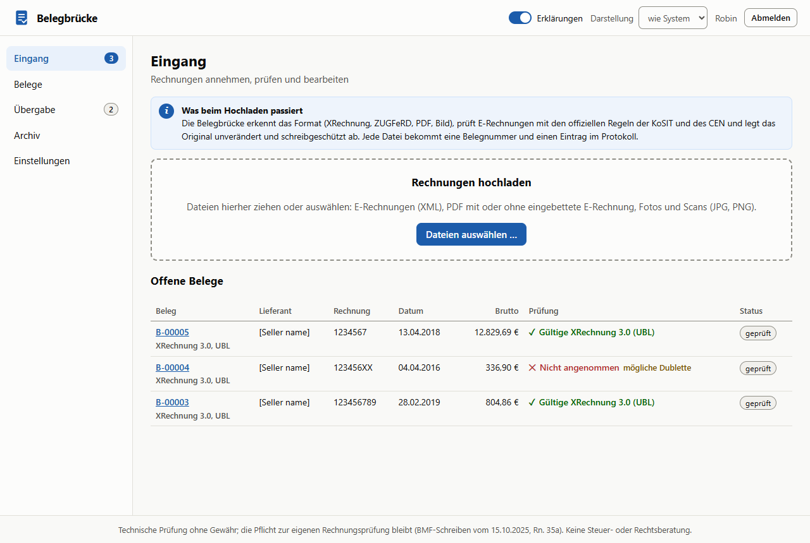
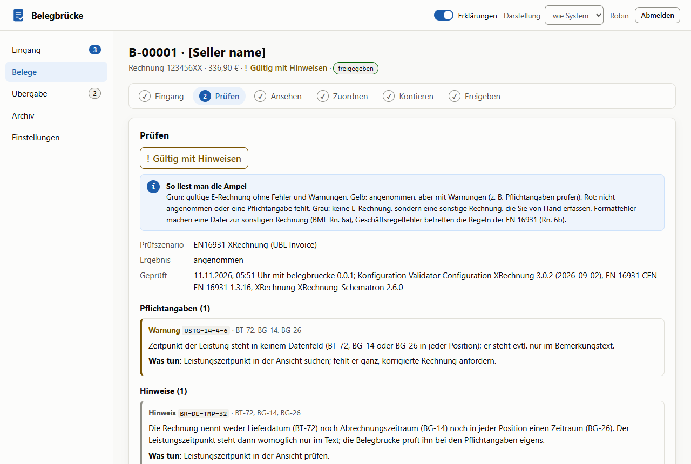
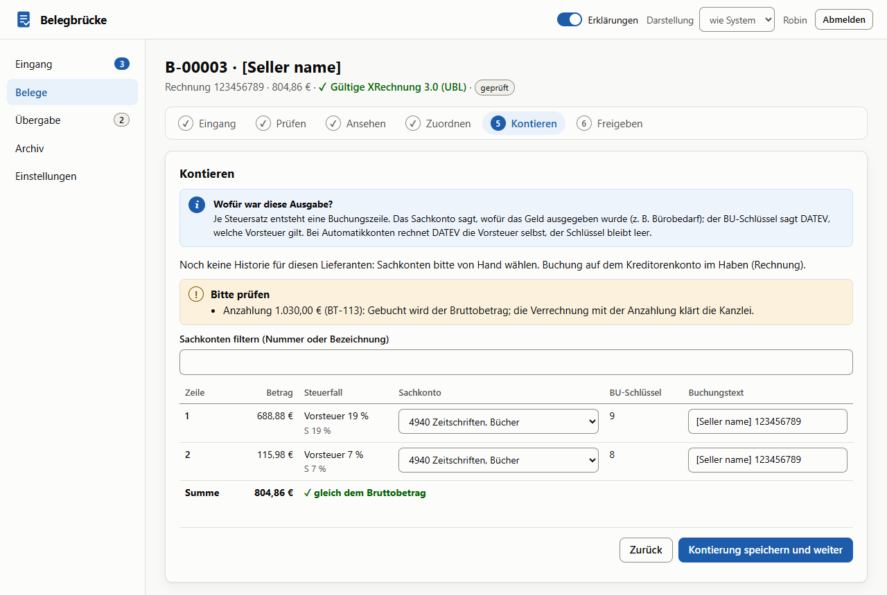
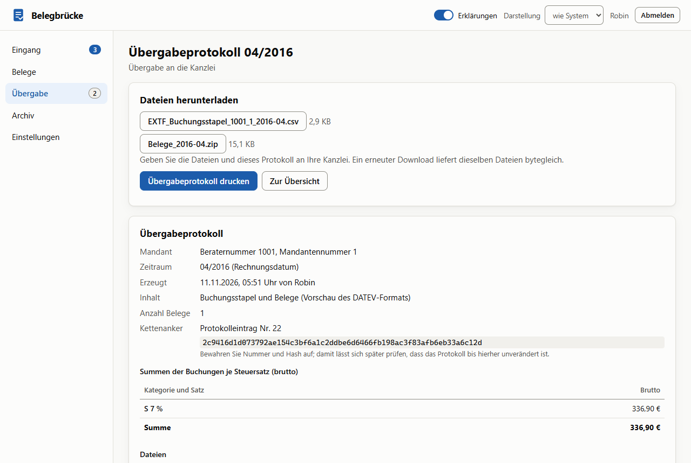
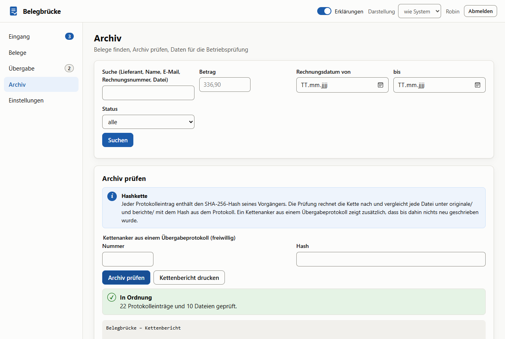

# Belegbrücke

E-Rechnungs-Eingang, GoBD-Archiv und DATEV-Übergabe für Kleinbetriebe. Die Belegbrücke nimmt eingehende E-Rechnungen an (Upload oder E-Mail-Postfach), prüft sie nach EN 16931 und XRechnung mit den offiziellen KoSIT- und CEN-Artefakten und erklärt Fehler in Klartext. Sie bewahrt das Original unverändert auf, mit Prüfbericht und einem Protokoll, das eine SHA-256-Hashkette sichert, führt durch Zuordnen, Kontieren und Freigeben und erzeugt monatlich die Übergabe an die Steuerkanzlei. Läuft lokal, ohne KI, ohne Cloud und ohne Java.

> **Stand: Version 0.1 in Arbeit.** Fertig sind Fachkern, Prüfung, Archiv, Server, Oberfläche, Kontierung mit DATEV-Übergabe und Postfach (Phasen 0 bis 5) sowie die Qualitätsschritte 6.1 bis 6.3; ein Prüferdurchgang am 11.11.2026 hat die Fachlogik nachgerechnet und sechs Fehler behoben (gleichzeitige Anfragen, Kleinbetrag bei negativem Betrag, Sperren nach Kontenänderungen, Erfassung von Hand bei 1280 Pixel, Umbruch bei 320 Pixel, Druck). Offen sind die Schritte mit Robin und der Kanzlei: DATEV-Formate an der Primärquelle prüfen (0.6), der Probeimport (4.7) und die Abnahme von `start.cmd`; bis dahin heißt der Export „Vorschau“. Stand: [docs/stand.md](docs/stand.md). Annahmen, die noch eine Entscheidung brauchen: [docs/entscheidungen.md](docs/entscheidungen.md). Spezifikation: [docs/spezifikation.md](docs/spezifikation.md).



## Was es kann

- **Eingang:** Upload per Ziehen und Ablegen (mehrere Dateien) und IMAP-Postfach mit Abruf in festem Abstand, nur über TLS. XML- und PDF-Anhänge werden Belege; jede Datei bekommt eine Belegnummer und einen Protokolleintrag.
- **Prüfung wie der KoSIT-Validator, ohne Java.** Die offiziellen Schematron-Regeln (CEN EN 16931 1.3.16, XRechnung 2.6.0) laufen als vorkompilierte XSLT in SaxonJS, das XML-Schema mit libxml2 als WebAssembly. Für alle 86 Testdateien der KoSIT-Testsuite und 8 Mutationen ergeben sich dieselben Szenarien, Regel-IDs, Stufen und Annahmen wie beim KoSIT-Validator 1.6.3 (Referenzlauf mit Java, Ergebnis als Test eingefroren).
- **Formate:** XRechnung 3.0 (UBL, CII, Extension, CVD), EN 16931, ZUGFeRD/Factur-X als PDF mit eingebettetem XML (EN 16931, BASIC, EXTENDED, XRECHNUNG). MINIMUM, BASIC WL, ZUGFeRD 1.0, PDF ohne XML und Fotos sind „sonstige Rechnungen“ und werden von Hand erfasst.
- **Klartext:** 61 Regeln der Regelwerke und 36 eigene mit deutscher Erklärung, Handlung und Einordnung nach dem BMF-Schreiben vom 15.10.2025 (Formatfehler, Geschäftsregelfehler, Inhaltsfehler; umsatzsteuerlich relevant oder nicht): [docs/regelkatalog.md](docs/regelkatalog.md). Ein Knopf kopiert eine fertige Rückfrage an den Lieferanten.
- **Pflichtangaben** nach § 14 Abs. 4 UStG, Kleinbetrag (§ 33 UStDV), Kleinunternehmer (§ 34a UStDV), Empfängerprüfung gegen die eigene Firma und Plausibilität (Steuersatz, IBAN-Prüfziffer, Datum, Währung). Ampel immer mit Symbol und Text.
- **Ansicht:** die HTML-Ansicht der KoSIT in einer Sandbox ohne Zugriff auf die App, daneben die Eckdaten; bei ZUGFeRD zusätzlich die PDF.
- **Dubletten** in drei Stufen (identische Datei, gleiche Rechnung auch über Formate hinweg, ähnliche Rechnung) mit Vergleich nebeneinander.
- **Kontierung:** Lieferanten mit Kreditorenkonto, Vorschlag aus der Historie je Lieferant, Kategorie und Steuersatz, BU-Schlüssel je Steuerfall, Soll/Haben auch für Gutschriften, Gründe für „von Hand prüfen“ (Anzahlung, Rundung, § 13b, Fremdwährung).
- **Freigabe** mit Bestätigung nach BMF Rn. 35a, Begründung bei Fehlern, Ablehnen mit Grund; danach sind Daten und Kontierung eingefroren.
- **Übergabe an die Kanzlei:** monatlich nach Rechnungsdatum, Nachträge für spätere Belege, EXTF-Buchungsstapel (Windows-1252) und Belegpaket (ZIP mit Originalen, Ansicht, Prüfberichten und `index.csv`), Übergabeprotokoll mit Kettenanker zum Drucken. Sperren nennen den Beleg und den Grund.
- **GoBD-Archiv:** Originale inhaltsadressiert und schreibgeschützt, Prüfbericht je Beleg, Protokoll mit SHA-256-Hashkette, Kettenprüfung samt Dateien und Kettenanker, Aufbewahrungsfrist nach § 147 AO und § 14b UStG, Suche nach Name, E-Mail, Nummer, Betrag und Zeitraum, Prüferexport für die Betriebsprüfung, tägliche Sicherung mit Wiederherstellungstest.
- **Server** auf 127.0.0.1 mit Anmeldung (scrypt, bis 3 Benutzer), Sperre nach Fehlversuchen, Schutz gegen CSRF und DNS-Rebinding, strenger CSP, Prüfung in Workern mit Zeit- und Speichergrenze; Postfach-Passwort mit AES-256-GCM.

| Prüfen | Kontieren |
| --- | --- |
|  |  |
| **Übergabeprotokoll** | **Archiv prüfen** |
|  |  |

## Fallbeispiel „Oktober“

Zwölf Belege eines Monats vom Eingang bis zur Übergabe; jede Zahl prüft [src/server/fallbeispiel.test.ts](src/server/fallbeispiel.test.ts). Die Rechnungen stammen aus der KoSIT-Testsuite, nur das Rechnungsdatum liegt im Oktober 2026 ([testdaten/fallbeispiel](testdaten/fallbeispiel), erzeugt mit `node scripts/fallbeispiel.mjs`); dazu eine PDF ohne XML, von Hand erfasst. Firma ist „[Buyer name]“ wie in den Testdateien, Kontenplan 4900 und 4901 (Automatikkonto).

| Nr. | Rechnung | Brutto | Was passiert |
| --- | --- | ---: | --- |
| 1 | 01.01a UBL, 123456XX | 336,90 € | freigegeben auf 4900, BU 8, Kreditor 70000 |
| 2 | 01.02a UBL | 12,60 € | Kleinbetrag (§ 33 UStDV), 4900, BU 8 |
| 3 | 01.03a CII | 182,20 € | 4900, BU 8 |
| 4 | 01.07a UBL | 45,22 € | Automatikkonto 4901, BU-Schlüssel leer |
| 5 | 01.09a UBL | 7.197,12 € | 4900, BU 9 |
| 6 | 02.01a UBL | 12.829,69 € | neuer Lieferant, Kreditor 70001; Zeile E 0 % mit 0,00 € entfällt |
| 7 | 03.01a UBL | 804,86 € | zwei Steuersätze (688,88 € und 115,98 €), Hinweis Anzahlung 1.030,00 € |
| 8 | 01.04a UBL | 120,00 € | Kategorie O, ohne Vorsteuer, Kreditor 70002 |
| 9 | 01.21a UBL | 233,00 € | § 13b (AE): kontiert, wartet auf den BU-Schlüssel der Kanzlei |
| 10 | 01.20a UBL | 357,00 € | Gutschrift über eigene Leistung (389): nur Beleg, keine Buchung |
| 11 | 01.01a CII | 336,90 € | dieselbe Rechnung wie Nr. 1: als Dublette abgelehnt |
| 12 | PDF ohne XML | 10,70 € | von Hand erfasst (Bäckerei Korn), Kreditor 70003 |

Übergabe 10/2026: 10 Belege, 10 Buchungszeilen, Nr. 9 bleibt offen. Summen der Buchungen: S 19 % 20.760,91 €, S 7 % 658,38 €, O 0 % 120,00 €, zusammen 21.539,29 €. Das Belegpaket enthält 10 Originale, 9 Ansichten, 10 Prüfberichte und `index.csv`; die Kettenprüfung mit dem Kettenanker des Laufs ist in Ordnung.

## Starten

Unter Windows genügt ein Doppelklick auf `start.cmd`: Beim ersten Start installiert es die Abhängigkeiten, lädt die Prüfartefakte und baut die Oberfläche; danach öffnet sich der Browser auf `http://127.0.0.1:8784`. Beim ersten Aufruf legt man den ersten Benutzer an, danach führt ein Assistent durch Firma, Kanzlei, Steuerschlüssel und Konten, Eingang (auf Wunsch mit Postfach) und Aufbewahrung. Daten liegen in `daten/` (änderbar mit `BB_DATEN`), der Schlüssel für das Postfach-Passwort daneben in `daten.schluessel` (`BB_SCHLUESSEL_DATEI`).

## Entwickeln

```bash
npm install
npm run vorbereiten   # KoSIT-Artefakte mit Prüfsumme laden, XSLT zu SEF kompilieren
npm run server        # Server auf 127.0.0.1:8784 (liefert dist/ aus, wenn gebaut)
npm run dev           # Oberfläche (Vite, Port 5184) mit Weiterleitung von /api an den Server
npm test              # Unit-Tests (Vitest), darunter der IMAP-Testserver über TLS
npm run abdeckung     # Zweigabdeckung der Fachlogik (Schwelle 90 %)
npm run e2e           # Browsertests gegen den echten Server auf Port 4184 (lokal mit Edge)
npm run build         # Typprüfung und Produktions-Build
npm run referenz      # Referenzlauf mit dem KoSIT-Validator (braucht Java 21 und npm run artefakte -- --referenz)
```

Weitere Skripte: `node scripts/mutationen.mjs` (Mutationen M1 bis M8), `node scripts/zugferd-testdaten.mjs` (Test-PDFs), `node scripts/fallbeispiel.mjs` (Fallbeispiel Oktober), `node scripts/readme-bilder.mjs` (Bilder dieser Seite, nach `npm run build`), `node scripts/referenz-mustang.mjs` (Mustang-Referenz, Java), `node scripts/regelkatalog.mjs` und `node scripts/lizenzen.mjs` (Doku).

**API** (JSON unter `/api`, ändernde Anfragen mit `X-Belegbruecke: 1` und passendem `Origin`): Sitzung (`/einrichtung/benutzer`, `/anmelden`, `/abmelden`, `/sitzung`, `/benutzer`), `/einstellungen`, Belege (`POST /belege` als multipart, `GET /belege?status=&monat=&suche=&von=&bis=&betrag=&offen=1`, `GET /belege/:id` mit Vorschlägen, `/original`, `/bericht`, `/ansicht`), Assistentenschritte (`POST /belege/:id/dublette`, `PUT /lieferant`, `PUT /kontierung`, `PUT /handerfassung`, `POST /freigeben`, `/ablehnen`, `/freigabe-zuruecknehmen`, `/ablehnung-aufheben`), Stammdaten (`/lieferanten`, `/sachkonten` mit CSV-Import), Übergabe (`GET /uebergaben`, `/uebergaben/plan?monat=`, `POST /uebergaben`, `/uebergaben/:id/dateien/:name`), Archiv (`POST /archiv/pruefen`, `/archiv/prueferexport`), Postfach (`/postfach/status`, `/postfach/test`, `/postfach/abrufen`, `PUT /postfach/passwort`).

## Aufbau

| Ordner | Inhalt |
| --- | --- |
| `src/fach` | Fachlogik ohne React und ohne Node-APIs: Datenmodell, Beträge, Formaterkennung, Pflichtangaben, Plausibilität, Dubletten, Lieferanten, Kontierung, Freigabe, Erfassung von Hand, Übergabe, DATEV (EXTF, Windows-1252, Belegpaket), Aufbewahrung, Hashkette, Klartext-Katalog |
| `src/pruefung` | Prüfung in Node-Workern: Szenarien, XSD (xmllint-wasm), Schematron und Ansicht (SaxonJS), PDF (pdf.js), Worker-Pool |
| `src/server` | Hono-Server: API, Eingang, Assistentenschritte, Übergabe, Prüferexport, Kettenprüfung, Postfach (imapflow, mailparser), SQLite (`node:sqlite`), Dateiablage, Anmeldung und Schutz |
| `src/ui` | React-Oberfläche: Anmeldung, Einrichtung, Eingang, Beleg-Assistent, Übergabe, Archiv, Einstellungen |
| `src/testhilfen` | Testserver, Test-Kontenplan, Test-Mails, IMAP-Testserver und Testzertifikat |
| `scripts` | Artefakte laden, SEF kompilieren, Referenzläufe, Testdaten, Bilder, Doku |
| `testdaten` | Mutationen, ZUGFeRD-Test-PDFs, Fallbeispiel, DATEV-Golden-File, Referenz-Snapshots (KoSIT-Testsuite per Skript) |
| `docs` | [Spezifikation](docs/spezifikation.md), [Stand](docs/stand.md), [Entscheidungen](docs/entscheidungen.md), [Datenmodell](docs/datenmodell.md), [Regelkatalog](docs/regelkatalog.md), [DATEV-Feldnotizen](docs/datev-felder.md), [Sicherheit](docs/sicherheit.md), [Lizenzen Dritter](docs/lizenzen-dritter.md) |

**Technik:** TypeScript 7, Node 24 (führt den Server direkt als TypeScript aus), React 19, Vite 8, Hono 4, zod 4, SaxonJS 2.7, xmllint-wasm 5, pdf.js 6, fflate, imapflow, mailparser, SQLite über `node:sqlite`, Vitest, Playwright mit axe.

## Qualität

- 286 Unit-Tests (Vitest) für alle Fachregeln mit von Hand nachgerechneten Werten, die Testfälle der Spezifikation (T-F, T-Z, T-V, T-X, T-P, T-D, T-K, T-E, T-I, T-H, T-A, T-S), die Testvektoren der Hashkette, das Fallbeispiel und gleichzeitige Anfragen (Doppelklick, zweites Fenster: nichts wird still überschrieben oder doppelt protokolliert); Zweigabdeckung der Fachlogik 94,7 % (Schwelle 90 % in `npm run abdeckung`).
- Gleichlauf mit dem KoSIT-Validator für alle 86 Testdateien der KoSIT-Testsuite (`testdaten/referenz/kosit-1.6.3.json`); EXTF-Ausgabe bytegleich mit einer Golden File (`testdaten/datev/EXTF_03.01a.csv`).
- 20 Browsertests gegen den echten Server: Einrichtung nur per Tastatur, Beleg bis zur Freigabe, Dublette, Erfassung von Hand, Übergabe, Archiv, Postfach gegen einen IMAP-Testserver, Kreditorenkonto im Schritt „Zuordnen“; jeder Schritt mit axe hell und dunkel ohne schwere Befunde; elf Hauptseiten bei 1280 und 320 Pixel ohne seitliches Verschieben (WCAG 1.4.10); Sicherheitsheader und CSP ohne Verstöße.
- Bei jedem Push laufen Lint, Unit-Tests und Build in der CI (sobald das private Repo auf GitHub angelegt ist); die Browsertests lokal vor jedem Commit.

## Grenzen

- Die DATEV-Formate sind noch nicht an der Primärquelle bestätigt und nicht von einer Kanzlei importiert; der Export heißt deshalb „Vorschau“. Das DUO-Paket (Belege online) ist aus.
- ZUGFeRD EXTENDED wird gegen EN 16931 geprüft; 12 Regeln, die bei gültigen EXTENDED-Rechnungen anschlagen, zählen dort nur als Warnung. ZUGFeRD 2.0 mit `urn:zugferd.de:2p0:`-Kennung ist noch nicht zugeordnet.
- Postfach nur mit Passwort oder App-Passwort über IMAP mit TLS; OAuth2 (Microsoft 365, Gmail) folgt später.
- Fremdwährung, PDF/A, Signaturen und Zeitstempel werden nicht geprüft bzw. nicht übergeben; Löschen nach Fristablauf kommt später.
- Listen laden alle Belege auf einmal (für Kleinbetriebe ausreichend, bei mehreren tausend Belegen langsam). Ein Upload darf zusammen höchstens 120 MB groß sein; größere Mengen in mehreren Schritten hochladen.
- Exportdateien werden beim erneuten Download nicht gegen ihren Hash geprüft; die Kettenprüfung umfasst wie spezifiziert nur `originale/` und `berichte/`. Das Übergabeprotokoll nennt Berater- und Mandantennummer, nicht den Firmennamen.

## Rechtliches

Technische Prüfung ohne Gewähr; die Pflicht zur eigenen Rechnungsprüfung bleibt (BMF-Schreiben vom 15.10.2025, Rn. 35a). Keine Steuer- oder Rechtsberatung. Software allein macht kein Verfahren GoBD-konform; nötig sind Verfahrensdokumentation, Zugriffsregeln und Sicherung. DATEV, ZUGFeRD und Factur-X werden nur beschreibend genannt.

## Lizenz

Noch nicht festgelegt (offene Frage 9 der Spezifikation). Das Repo ist privat. SaxonJS steht unter einer proprietären, kostenlosen Lizenz; Einzelheiten in [docs/lizenzen-dritter.md](docs/lizenzen-dritter.md).
